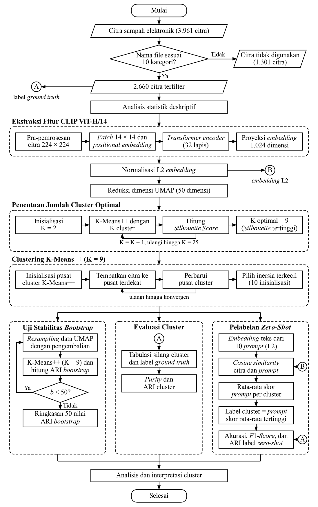

# Pengelompokan Citra Sampah Elektronik Berbasis CLIP ViT-H/14 dengan Algoritma K-Means++

Repositori ini berisi kode program skripsi Departemen Statistika, Fakultas Sains dan Matematika,
Universitas Diponegoro (2026). Penelitian ini mengelompokkan citra sampah elektronik **tanpa label**:

1. fitur citra diekstraksi dengan image encoder CLIP ViT-H/14;
2. embedding dinormalisasi L2 dan direduksi dengan UMAP;
3. citra dikelompokkan dengan K-Means++, dengan jumlah cluster dipilih dari Silhouette Score tertinggi;
4. setiap cluster diberi nama secara otomatis dengan CLIP zero-shot;
5. hasilnya diuji stabilitasnya dengan bootstrap dan dievaluasi terhadap kategori sebenarnya.

Label kategori (dari prefiks nama file) **tidak pernah dipakai** saat clustering. Label hanya dipakai
sebagai pembanding (ground truth) pada tahap evaluasi.

## Alur penelitian

<p align="center"></p>

## Tautan

| Sumber | Tautan |
|---|---|
| Dataset penelitian (Kaggle) | https://www.kaggle.com/datasets/samuelfrans/bdc2026-dataset |
| Pretrained model CLIP ViT-H/14 (Kaggle) | https://www.kaggle.com/refs/hf-model/laion/CLIP-ViT-H-14-laion2B-s32B-b79K |

Dataset berasal dari kompetisi SATRIA DATA 2026. Folder yang dianalisis adalah `train/1_Electronic`.

## Isi repositori

Repositori ini menyediakan dua cara membaca dan menjalankan analisis:

1. **Notebook analisis Bab IV** (`notebooks/Analisis_Bab_IV.ipynb`). Ini adalah notebook yang dijalankan di
   Kaggle untuk menghasilkan seluruh tabel, gambar, dan perhitungan manual pada Bab IV. Nomor bagiannya
   sama dengan subbab skripsi (4.1 sampai 4.10) dan seluruh output-nya sudah tersimpan, sehingga dapat
   dibaca langsung di GitHub tanpa menjalankan ulang.
2. **Skrip pipeline** (`run_pipeline.py` dan `src/ewaste_clustering/`). Ini adalah versi ringkas dan
   modular dari alur yang sama, dipisah per tahap analisis, untuk menjalankan ulang penelitian dengan
   satu perintah.

```
├── notebooks/
│   └── Analisis_Bab_IV.ipynb    # analisis lengkap Bab IV beserta output dan perhitungan manual
├── run_pipeline.py              # menjalankan seluruh alur dari citra sampai evaluasi
├── src/ewaste_clustering/
│   ├── config.py                # seluruh parameter penelitian (seed, K, UMAP, prompt, ...)
│   ├── data.py                  # 1. input dan filterisasi data
│   ├── features.py              # 2. ekstraksi fitur CLIP ViT-H/14
│   ├── reduction.py             # 3. normalisasi L2 dan reduksi dimensi UMAP
│   ├── clustering.py            # 4. pemilihan K (Silhouette Score) dan K-Means++
│   ├── zeroshot.py              # 5. penyusunan prompt dan pelabelan CLIP zero-shot
│   └── evaluation.py            # 6. evaluasi internal, bootstrap, dan evaluasi eksternal
├── results/                     # keluaran run_pipeline.py pada GPU Tesla T4
├── docs/diagram_alir.png
└── requirements.txt
```

## Cara menjalankan

### Di Kaggle (disarankan)

1. Buat notebook baru, aktifkan **GPU T4** dan **Internet**.
2. Tambahkan dataset `samuelfrans/bdc2026-dataset` sebagai input.
3. Jalankan:

```bash
!git clone https://github.com/Ransouong/clipvith14_kmeans.git
%cd clipvith14_kmeans
!pip install -q open_clip_torch==3.3.0 umap-learn
!python run_pipeline.py --out-dir /kaggle/working/outputs
```

Folder `1_Electronic` dicari otomatis di `/kaggle/input`. Bobot CLIP diunduh otomatis oleh `open_clip`
saat pertama kali dijalankan. Waktu proses sekitar 10 menit pada satu GPU T4 (di luar instalasi paket dan unduhan bobot model).

### Di komputer lokal

```bash
pip install -r requirements.txt
python run_pipeline.py --data-dir path/ke/train/1_Electronic --out-dir outputs
```

Ekstraksi fitur ViT-H/14 tanpa GPU dapat memakan waktu beberapa jam.

## Parameter penelitian

| Tahap | Parameter |
|---|---|
| Filterisasi | 10 kategori: Battery, Keyboard, Microwave, Mobile, Mouse, PCB, Player, Printer, Television, Washing Machine |
| Ekstraksi fitur | `open_clip` ViT-H-14, bobot `laion2b_s32b_b79k`, batch 64, embedding 1.024 dimensi |
| Reduksi dimensi | UMAP, `n_neighbors=30`, metrik kosinus; 50 dimensi (`min_dist=0.0`) untuk clustering, 2 dimensi (`min_dist=0.1`) untuk visualisasi |
| Clustering | K-Means++ dengan `n_init=10`, K diuji 2 sampai 25, K optimal = Silhouette Score tertinggi |
| Stabilitas | 50 sampel bootstrap, dibandingkan dengan ARI |
| Zero-shot | prompt `"a photo of {kategori}"`, label = rata-rata cosine similarity tertinggi per cluster |
| Seed | 42 |

## Hasil utama

| Metrik | Nilai |
|---|---|
| Citra yang dianalisis / tidak digunakan | 2.660 / 1.301 |
| K optimal (Silhouette Score tertinggi) | 9 (0,8235) |
| Rata-rata ARI bootstrap (50 kali) | 0,9997 |
| Purity hasil clustering | 0,8793 |
| ARI hasil clustering | 0,8377 |
| NMI hasil clustering | 0,9021 |
| Accuracy label zero-shot | 0,7883 |
| F1-Score makro label zero-shot | 0,7220 |
| ARI label zero-shot | 0,7483 |

Delapan dari sembilan cluster didominasi satu kategori. Satu cluster menggabungkan citra Television dan
Microwave, dan cluster yang berisi citra Player diberi label Mobile oleh CLIP zero-shot. Rincian
pembahasan ada pada Bab IV skripsi dan pada notebook `notebooks/Analisis_Bab_IV.ipynb`.

## Lingkungan komputasi

Python 3.13, PyTorch 2.11 (CUDA 13.0), open_clip 3.3.0, umap-learn 0.5.12, scikit-learn 1.6.1,
NumPy 2.1.3, GPU NVIDIA Tesla T4 (Kaggle).

## Rujukan utama

- Radford, A. et al. (2021). Learning transferable visual models from natural language supervision. *ICML*.
- Cherti, M. et al. (2023). Reproducible scaling laws for contrastive language-image learning. *CVPR*.
- McInnes, L., Healy, J., & Melville, J. (2018). UMAP: Uniform manifold approximation and projection for dimension reduction. *arXiv:1802.03426*.
- Arthur, D., & Vassilvitskii, S. (2007). k-means++: The advantages of careful seeding. *SODA*.
- Rousseeuw, P. J. (1987). Silhouettes: A graphical aid to the interpretation and validation of cluster analysis. *Journal of Computational and Applied Mathematics*, 20, 53–65.
